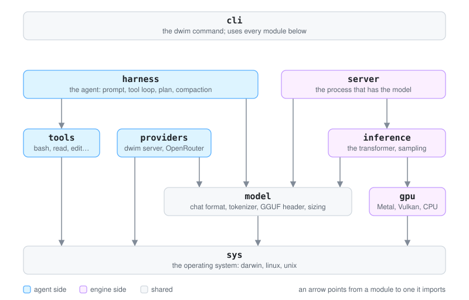

# Contributing

## Building

`cargo build` needs nothing beyond Rust. The Vulkan kernels are compiled from
WGSL to SPIR-V by `naga` in `build.rs`; CUDA and Metal compile their own
kernels from source when the device opens, CUDA's with NVRTC, which it loads
then along with the driver.

```
cargo build              # debug, with the model and the devices optimized
cargo build --release    # for anything that runs the model for long
make install             # a release build and the manual page, in ~/.local
```

`make install PREFIX=/usr/local` installs system-wide, which may need `sudo`;
`make uninstall` removes what `make install` put there.

Running the model on a GPU needs Metal on macOS, and elsewhere an NVIDIA
driver with the CUDA toolkit's NVRTC library, or a Vulkan 1.1 driver with
`VK_KHR_push_descriptor`. CUDA is tried first where there is a driver, and
`--device cuda` or `--device vulkan` insists on one. `--device cpu` runs
anywhere, slowly.

The weights are downloaded on first use into the Hugging Face cache,
`~/.cache/huggingface/hub`, in the layout the `huggingface_hub` library
uses, so a copy that `hf download` or another tool fetched is used as it
is. Qwen3.8-27B, the one model, is a 16 GB file; an interrupted download
resumes on the next run, and `dwim --download` fetches it ahead of a
session and prints where it is. `HF_HOME`, `HF_HUB_CACHE`, `HF_HUB_OFFLINE`
and `HF_ENDPOINT` mean what they mean to the library.

## Running

```
dwim                     # the shell
dwim "what changed in the last commit?"
dwim --device cpu --context 4096 "what files are here?"
```

With a prompt, `dwim` answers it and exits. The reply goes to standard output
and nothing else does, so `dwim "…" 2>/dev/null` gives the reply alone, while
progress, the model's thinking, the commands it runs, and their output go to
standard error.

The model is loaded by a server, `dwim --serve`, which a session starts
itself when none is listening and which exits after ten minutes without a
session, so a second session, in another terminal, finds the model loaded
and takes turns with the first. The weights are shared, and each session
has its own key/value caches and recurrent states on the device, room for
`--sessions` of them (two by default) allocated when the server starts.
The server is the same binary as the
session: after a rebuild, the next session finds the running server is from
another build and replaces it, if it has no sessions, so a stale one is not
served by mistake. What the server reports goes to
`~/.local/state/dwim/server.log` (`~/Library/Application Support/dwim/` on
macOS).

## Architecture



dwim has two sides that meet in `model`. The agent side is `harness`, the
`tools` it calls, and the `providers` it asks for a reply. The engine side is
`server`, `inference`, and `gpu`. Neither side imports the other: a provider
reaches the dwim server over a Unix socket, so the agent builds and runs
without the transformer or a GPU. `model` is what both sides know of the
model (the chat format, the tokenizer, its size), `sys` is what is asked of
the operating system, and `cli` puts it all together.

Every arrow points down, and a new import should too. A module does not
import one above it or beside it, and `model` imports nothing but `sys`.
Tests are the exception: the harness tests run the agent loop against a
scripted model from `inference`.

## Verifying a change

```
cargo test               # the GPU kernels are checked against the CPU reference
cargo clippy --all-targets -- -D warnings
cargo fmt --check
```

CI runs these with the toolchain `rust-toolchain.toml` pins, which `rustup`
picks up here too.

`cargo test gpu::` skips a backend whose GPU is not available, so it
passes on a machine with no GPU without having checked anything. With the
model in the cache, `cargo test real_model -- --ignored --nocapture`
completes a prompt with it and reports the speed, with and without the
drafter, and
`cargo run --bin difftest` checks the GPU against the CPU with it, on a
few prompts run in pieces of different sizes and on their continuations
run a token at a time, and on the same prompts run again with a detour
marked and rewound halfway through, as a session drops a thought. The CPU's
side is
recorded into `target/difftest/` on the first run, which takes minutes, and
again only when the CPU's or the model's code changes; after that a run
takes seconds. `--repeat <n>` runs the GPU's side again, for mistakes it
makes only now and then.

Run the agent before calling a change done. The model is easy to break in
ways tests don't catch, such as replies that end with nothing to show, so
ask it something in the shell, and check a one-off prompt too.

The coding style is in `AGENTS.md`. Commit messages say what changed and why,
in the imperative, with the reasoning in the body. A commit whose change
`dwim` made ends with the line `Generated-by: dwim`. The person who commits
it has read the change and stands behind it, and the message is theirs.

## SWE-bench

[SWE-bench](https://www.swebench.com) gives an agent a real GitHub issue and
a repository at the commit before the fix, and checks the agent's patch by
running the project's tests. `evals/swebench/run.py` runs `dwim` over one of
its datasets: `verified-mini`, 50 instances of Verified chosen to be as hard
on the whole, which is the default; `verified`, the 500 that people checked
can be solved from the issue; or `lite`, 300 from 12 Python projects.

```
evals/swebench/run.py --instance django__django-11790  # one instance
evals/swebench/run.py --limit 10                       # the first ten
evals/swebench/run.py                                  # all 50
evals/swebench/run.py --dataset lite -- --temperature 0
evals/swebench/run.py --agent opencode                 # another agent
evals/swebench/run.py --pull                           # fetch the images
evals/swebench/run.py --gold                           # check the scoring
```

The script builds `dwim`, and for each instance takes the repository as the
instance's SWE-bench image has it, with the project and what it needs
installed, gives `dwim` the issue with its shell commands running in a
container of that image without a network (`dwim --shell`), takes what it
changed as the patch, and scores the patch with the official harness, which
runs the project's tests in a fresh container of the same image. What
follows `--` is given to `dwim`. It needs Docker and
[uv](https://docs.astral.sh/uv/), which runs the script and installs the
harness for it; on Apple Silicon it needs a Docker that runs x86_64 images,
such as Colima started with `--vz-rosetta`. `--help` lists the rest.

A run is a directory under `evals/runs/`, named for the dataset, the agent,
and the commit of `dwim`. Its `manifest.json` says what was run, its
`report.md` what came of it, and each instance has a directory with its
`result.json`, its `patch.diff`, the transcript and the logs. A run over a
whole dataset also writes its report to `evals/results/`, which is kept in
git: commit it with the change it measures. The commit a run is named for
is the last to change anything but `evals/`, so that a change to the script
is not taken for a change to `dwim`. The same command again takes the run
up where it stopped: it leaves the instances that are done, tries again
those that could not be run for a reason that was not the agent's, such as
a pull that failed, and scores the patches that are not scored. A run is of one dataset by one
`dwim` asked one way, so a change to any of them wants a run of its own.

`--agent opencode` runs [opencode](https://opencode.ai) in place of `dwim`,
on the same model through the Vercel AI Gateway unless `--model` names
another, with its shell commands in the same container and its tools that
reach the web turned off. It has to be installed and signed in (`opencode
auth login`); its own configuration and instructions in your home are kept
out of the run. `dwim` goes to whichever provider it would for you, which
the report names: say `-- --provider vercel` to hold it to one.

Before trusting the numbers on a machine, run `--gold` once: it scores the
dataset's own fixes in place of the agent's, and they all resolve where the
images and the harness work. The model's sampling is not seeded, so run the
same `dwim` a few times, each with a `--run-id` of its own, to see how much
the count moves by itself before reading anything into a difference.

Each instance has an image of its own, a few gigabytes that take minutes
to pull and unpack, where its tests run in seconds. `--pull` pulls them
all and stops, so that the wait is had once and out of the way of a run;
`--workers` is how many at once. The images stay in Docker for the next
run, and nothing here removes them: `docker image rm` does, when you are
done with a dataset.

**The agent's commands run in the container, but the model runs here, and
its read and edit tools work on the checkout as you, on an untrusted
issue.** Run it in a virtual machine, not on a machine you care about.

## Releasing

The version is in `Cargo.toml`.

```
scripts/release 0.2.0
git push --atomic origin main v0.2.0
```

`scripts/release` sets the version in `Cargo.toml`, `Cargo.lock` and the
manual page, commits it as `dwim v0.2.0`, and tags the commit `v0.2.0`, but
pushes nothing. Pushing the tag runs `.github/workflows/release.yml`, which
checks that the tag matches `Cargo.toml`, builds `dwim` for Apple silicon
macOS and x86-64 and ARM64 Linux, and publishes them as a GitHub release.
`https://dwim.sh/install.sh` installs the latest release from there.

## Maintenance

Two agent skills help keep the code easy for agents and people to work in:

* [`untangle-codebase`](https://skill-sets.md/skills/caldoai/skills/untangle-codebase/)
  refactors the whole codebase in one pass, so a change needs less of it
  read and breaks less without anyone noticing. It is installed in
  `.agents/skills/`, and `/untangle-codebase` runs it, optionally on one
  area or concern.
* [BeautifulRust](https://github.com/morganlinton/BeautifulRust) teaches
  an agent idiomatic Rust: `rust-best-practices` steers code as it is
  written, and `rust-review` reviews a file, a module or a diff and
  reports what to fix, citing the rule each finding breaks. Where it and
  `AGENTS.md` disagree, `AGENTS.md` wins.
