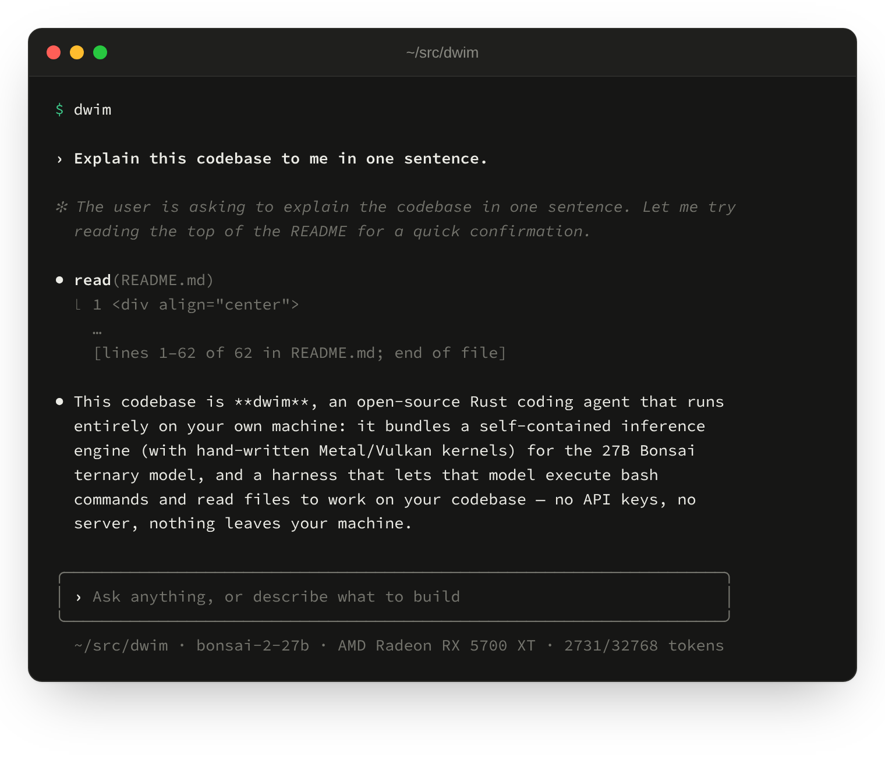

<div align="center">
  

# dwim

*Do what I mean.*

**A coding agent that runs on your own GPU.**

The agent, the model, and the engine that runs it, in one Rust program:
no API key, no server, and nothing leaves your machine.

[](https://huggingface.co/Qwen/Qwen3.8-27B)
[](LICENSE.md)

</div>

> [!WARNING]
> **dwim is experimental software.** Expect bugs, rough edges, and changes that
> break things from one commit to the next. The model runs shell commands on
> your machine without asking first, so use it on code you have committed or
> backed up.

## Installation

To install the latest release:

```console
curl -fsSL https://dwim.sh/install.sh | sh
```

To install the latest development version:

```console
cargo install --git https://github.com/dwim-sh/dwim
```

Or, from a checkout, with the manual page:

```console
make install                     # in ~/.local
make install PREFIX=/usr/local   # system-wide, which may need sudo
```

Either way, the model (16 GB) is downloaded on first use into your
Hugging Face cache, where `hf download` and other tools would put it, and
used from there if one of them already did. `dwim --download` fetches it
ahead of time.

## Features

- **Fully local coding agent.** Runs commands, reads their output, and keeps
  going.
- **Qwen3.8-27B.** At four bits, 16 GB, on a machine with 32 GiB of memory
  or more, decoding several tokens at a time with the drafter its file
  ships.
- **Fast local inference.** Metal on macOS, CUDA or Vulkan on Linux.
- **Bring your own sandbox.** `dwim` expects to run inside a sandbox, such as
  a container or a virtual machine, and does not confine the model itself.
  Commands run without confirmation and without a time limit, until they
  finish.

## Getting started

Run `dwim` in a project directory. It opens a shell: type what you want, and
the model reads files, runs commands, and answers.

<div align="center">
  
</div>

To ask one thing and exit, give the prompt on the command line:

```console
dwim "Explain this codebase to me in one sentence."
```

The manual page has the options, the shell's commands and keys, and the files
it reads:

```console
man dwim
```

## License

[MIT](LICENSE.md).
